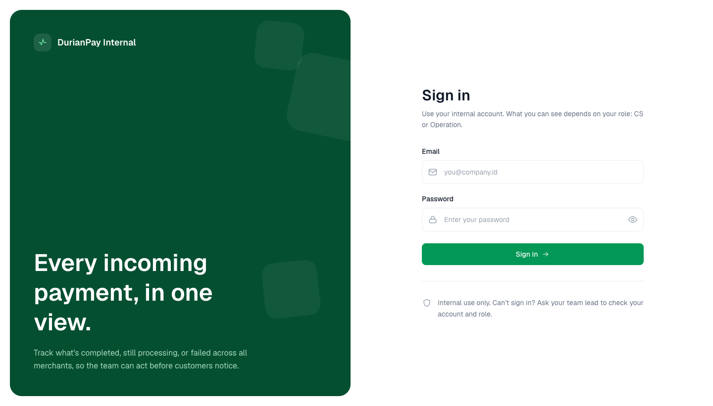
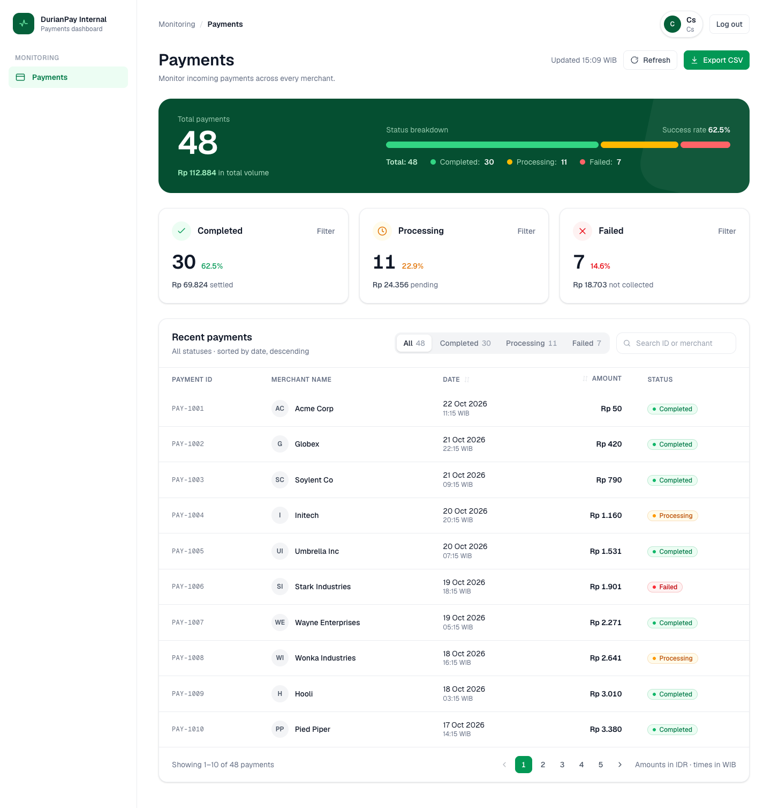

# DurianPay Internal Dashboard

An internal payments dashboard: staff log in, see a payments summary, and browse, filter,
search, and export incoming payments. Go REST API (OpenAPI-first, SQLite) + Next.js 16
dashboard (React 19, TanStack Query, Tailwind).

- **Backend:** `backend/` — Go 1.25, chi + OpenAPI request validation, SQLite.
- **Frontend:** `frontend/` — Next.js 16 App Router, React 19, TanStack Query.
- **API contract:** `openapi.yaml` (repo root) — single source of truth for both sides.
- **Design docs:** `_docs/` — [PRD](./_docs/PRD.md), [Architecture](./_docs/Architecture.md),
  and [the review log of issues/gaps and fixes](./_docs/artifacts.md).

---

## Screenshots

Captured from the running stack (`docker compose up --build`), signed in as the seeded
`cs@test.com` account.

**Login** — `http://localhost:3000/login`



**Payments dashboard** — summary + filterable/searchable payments table (48 seeded records)



---

## 1. Prerequisites

| Tool | Version | Notes |
| --- | --- | --- |
| Go | 1.21+ (built on 1.25) | `CGO_ENABLED=1` is required — the SQLite driver is cgo-based, so a C toolchain (Xcode CLT on macOS / `build-essential` on Linux) must be present. |
| Node.js | 20+ | |
| pnpm | 9+ (repo pins `pnpm@12.14.0`) | `corepack enable` will provide it. |
| make | any | Backend task runner. |

Persistence is **SQLite** — no external database to install. The DB file is created and
seeded automatically on first run.

---

## 2. Quick start with Docker (one command)

Requires Docker + Docker Compose. From the repo root:

```bash
docker compose up --build
```

- **Frontend:** http://localhost:3000
- **Backend / Swagger UI:** http://localhost:8080 · http://localhost:8080/docs

The backend container **runs the migration and data seed automatically on first boot**
(schema + demo users + 48 payments — see [Seed data](#5-seed-data)), stored on the
`db-data` volume so it persists across restarts. The frontend waits until the backend's
`/ready` health check passes before starting. Sign in with a seeded account below.

```bash
docker compose down        # stop (keeps data)
docker compose down -v     # stop and wipe the DB volume → fresh reseed next up
```

> API calls are made from the browser, so the frontend image is built with
> `NEXT_PUBLIC_API_BASE_URL=http://localhost:8080` (the host-published backend port). If
> you expose the backend elsewhere, rebuild with `--build-arg`/the compose `args`.

## 3. Quick start without Docker (two terminals)

### Terminal 1 — backend (http://localhost:8080)

```bash
cd backend
cp env.sample .env          # first-time setup
make gen-secret             # prints a JWT_SECRET — paste it into .env
make run                    # CGO_ENABLED=1 go run main.go
```

On first start the backend creates `backend/dashboard.db` and **seeds** it (see
[Seed data](#5-seed-data)). It logs `starting server` and listens on `:8080`.

### Terminal 2 — frontend (http://localhost:3000)

```bash
cd frontend
pnpm install
pnpm dev                    # Next.js dev server (Turbopack)
```

Open **http://localhost:3000**, you'll be redirected to `/login`. Sign in with a seeded
account (below) and you land on the dashboard.

---

## 4. Configuration

### Backend (`backend/.env`, see `env.sample`)

| Variable | Default | Purpose |
| --- | --- | --- |
| `APP_ENV` | `development` | `production` turns on fail-fast config checks (strong secret, no `*` CORS). |
| `HTTP_ADDR` | `:8080` | Listen address. |
| `JWT_SECRET` | `dev-secret-replace-me` | **Must** be set (≥ 32 bytes) in production — `make gen-secret`. |
| `JWT_EXPIRED` | `24h` | Token lifetime. |
| `CORS_ALLOWED_ORIGINS` | `http://localhost:3000` | Comma-separated browser origin allow-list (`*` = any, dev only). |
| `DB_PATH` | `dashboard.db` | SQLite file location (Docker points this at a mounted volume). |
| `OPENAPIYAML_LOCATION` | `../openapi.yaml` | Path to the spec served at `/openapi.yaml`. |

### Frontend (`frontend/.env.local`, optional)

| Variable | Default | Purpose |
| --- | --- | --- |
| `NEXT_PUBLIC_API_BASE_URL` | `http://localhost:8080` | Backend base URL the browser calls. |

---

## 5. Seed data

The first backend run (empty DB) seeds deterministically — delete `backend/dashboard.db`
to reseed:

- **Users** (password `password` for both):
  - `cs@test.com` — role `cs`
  - `operation@test.com` — role `operation`
- **Payments:** 48 records across 15 merchants, weighted ~60% completed / ~25% processing
  / ~15% failed, with amounts and timestamps spread over ~30 days so the summary and
  filters are meaningful.

---

## 6. Build & run for production

### Backend
```bash
cd backend
make build                  # → ./bin/mygolangapp
APP_ENV=production JWT_SECRET=<32+ byte secret> \
  CORS_ALLOWED_ORIGINS=https://your-frontend ./bin/mygolangapp
```

### Frontend
```bash
cd frontend
pnpm build                  # production build
pnpm start                  # serve on :3000
```

---

## 7. Tests

### Backend — `make test` (table-driven, no DB/cgo needed for the unit layer)
```bash
cd backend && make test                      # CGO_ENABLED=1 go test ./...
# single package:
CGO_ENABLED=1 go test ./internal/module/payment/usecase/ -run TestListPayments
```
Covered: auth usecase (login, wrong password, unknown-user → 401), payment usecase
(validation, pagination defaults/clamping, summary), payment repository SQL builders
(ORDER BY allow-list, WHERE/LIKE escaping — injection cases), and the login rate limiter.

### Frontend — `pnpm test` (Vitest + React Testing Library, jsdom)
```bash
cd frontend && pnpm test                     # or: pnpm test:watch
```
Covered: pure formatters/`summarize` (currency, WIB dates, summary math), `LoginForm`
(validation, trimming, password toggle, server-error display), and `StatusBadge`.

See [`_docs/Architecture.md` §6](./_docs/Architecture.md) for the full testing strategy.

---

## 8. API documentation

With the backend running:

- **Swagger UI:** http://localhost:8080/docs
- **Raw spec:** http://localhost:8080/openapi.yaml (same as `openapi.yaml` at repo root)
- **Ops probes:** `GET /health` (liveness), `GET /ready` (readiness — pings the DB)

Endpoints: `POST /dashboard/v1/auth/login` (public, rate-limited), `GET /dashboard/v1/payments`
(bearer; `status`, `search`, `page`, `per_page`, `sort`), `GET /dashboard/v1/payments/summary`
(bearer).

---

## 9. Project layout

```
.
├── openapi.yaml            # API contract (source of truth)
├── docker-compose.yml      # one-command full stack (backend + frontend + volume)
├── _docs/                  # PRD.md, Architecture.md, artifacts.md (review log)
├── backend/                # Go API — see backend/README.md
│   ├── internal/
│   │   ├── api/            # aggregates module handlers into the generated ServerInterface
│   │   ├── config/         # env parsing + production fail-fast validation
│   │   ├── entity/         # shared domain types + error model
│   │   ├── middleware/     # CORS, JWT auth, request-id, access log, rate limit
│   │   ├── module/{auth,payment,health}/  # handler → usecase → repository layers
│   │   ├── service/http/   # router assembly, validator, graceful shutdown
│   │   └── transport/      # AppError → HTTP status + JSON
│   └── main.go             # wiring, DB init + seed, slog setup
└── frontend/               # Next.js dashboard — see frontend/README.md
    ├── app/                # routes (/, /login, /dashboard) + error boundary
    ├── views/{container,presentation,ui}/  # smart / dumb / primitives
    ├── services/           # TanStack Query hooks + contracts
    ├── libs/ hooks/        # api-client, auth store, formatters, guards
    └── *.test.ts(x), vitest.config.ts
```
