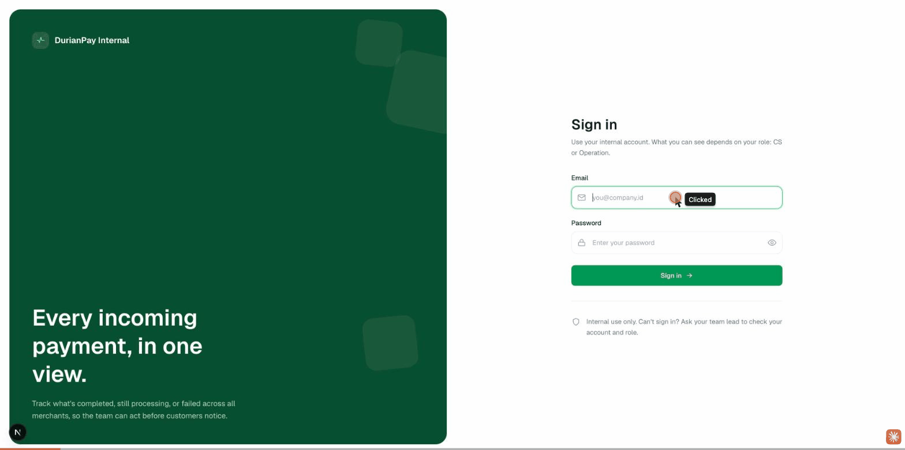
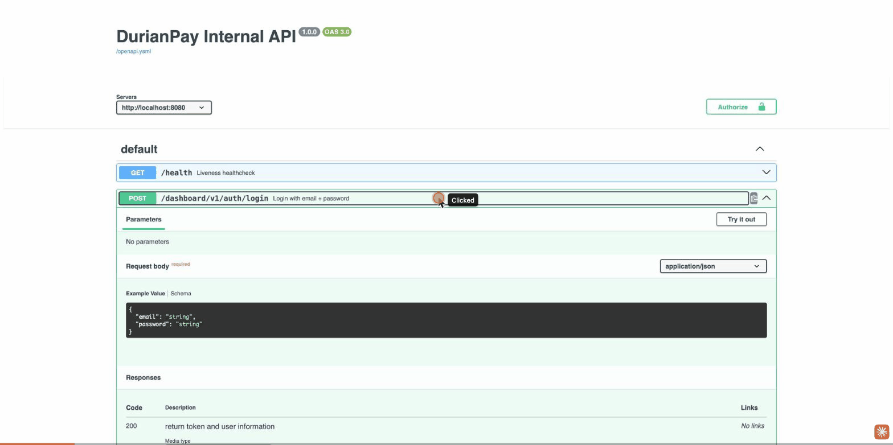

# DurianPay Internal Dashboard

An internal payments dashboard: staff log in, see a payments summary, and browse, filter,
search, and export incoming payments. Go REST API (OpenAPI-first, SQLite) + Next.js 16
dashboard (React 19, TanStack Query, Tailwind).

- **Backend:** `backend/` — Go 1.25, chi + OpenAPI request validation, SQLite.
- **Frontend:** `frontend/` — Next.js 16 App Router, React 19, TanStack Query.
- **API contract:** `openapi.yaml` (repo root) — single source of truth for both sides.
- **Design docs:** `_docs/` — [PRD](./_docs/PRD.md), [Architecture](./_docs/Architecture.md),

---


## Screenshots

Captured from the running stack (`docker compose up --build`), signed in as the seeded
`cs@test.com` account.

**Login** — `http://localhost:3000/login`


**Payments dashboard** — summary + filterable/searchable payments table (48 seeded records)


---


## Testing evidence

Captured end-to-end against the live stack (`backend` on `:8080`, `frontend` on `:3000`)
on 2026-10-23. Artifacts live in `[docs/evidence/](./docs/evidence)`.

### Frontend visual testing

Signed in as `operation@test.com`, then exercised the dashboard: summary hero, the
status filter (All → Failed), and merchant search — ending in a combined
filter + search that narrows 48 records to one.



### API testing (Swagger UI)

Driving the running API through its own Swagger UI at `http://localhost:8080/docs`:
expand `POST /dashboard/v1/auth/login`, **Try it out** with real seeded credentials,
**Execute** → live `200` with the issued JWT.



### API testing (curl transcript)

Real request/response pairs for **all six** endpoints plus the two security-boundary
negatives — a tokenless call (`401`) and a `cs` export attempt (`403`, RBAC). Full log:
`[docs/evidence/api-test-transcript.md](./docs/evidence/api-test-transcript.md)`.


| #   | Endpoint                                        | Auth   | Result                 |
| --- | ----------------------------------------------- | ------ | ---------------------- |
| 1   | `GET /health`                                   | public | `200` ok               |
| 2   | `POST /dashboard/v1/auth/login` (cs)            | public | `200` + token          |
| 3   | `POST /dashboard/v1/auth/login` (operation)     | public | `200` + token          |
| 4   | `GET /dashboard/v1/auth/me`                     | bearer | `200` identity         |
| 5   | `GET /dashboard/v1/payments?status=completed`   | bearer | `200` paginated        |
| 6   | `GET /dashboard/v1/payments/summary`            | bearer | `200` aggregates       |
| 7   | `GET /dashboard/v1/payments/export` (operation) | bearer | `200` full set         |
| 8   | `GET /dashboard/v1/payments/export` (cs)        | bearer | `403` forbidden (RBAC) |
| 9   | `GET /dashboard/v1/payments` (no token)         | —      | `401` unauthorized     |


---


## 1. Prerequisites


| Tool    | Version                       | Notes                                                                                                                                             |
| ------- | ----------------------------- | ------------------------------------------------------------------------------------------------------------------------------------------------- |
| Go      | 1.21+ (built on 1.25)         | `CGO_ENABLED=1` is required — the SQLite driver is cgo-based, so a C toolchain (Xcode CLT on macOS / `build-essential` on Linux) must be present. |
| Node.js | 20+                           |                                                                                                                                                   |
| pnpm    | 9+ (repo pins `pnpm@12.14.0`) | `corepack enable` will provide it.                                                                                                                |
| make    | any                           | Backend task runner.                                                                                                                              |


Persistence is **SQLite** — no external database to install. The DB file is created and
seeded automatically on first run.

---


## 2. Quick start with Docker (one command)

Requires Docker + Docker Compose. From the repo root:

```bash
docker compose up --build
```

- **Frontend:** [http://localhost:3000](http://localhost:3000)
- **Backend / Swagger UI:** [http://localhost:8080](http://localhost:8080) · [http://localhost:8080/docs](http://localhost:8080/docs)

The backend container **runs the migration and data seed automatically on first boot**
(schema + demo users + 48 payments — see [Seed data](#5-seed-data)), stored on the
`db-data` volume so it persists across restarts. The frontend waits until the backend's
`/ready` health check passes before starting. Sign in with a seeded account below.

```bash
docker compose down        # stop (keeps data)
docker compose down -v     # stop and wipe the DB volume → fresh reseed next up
```

> API calls are made from the browser, so the frontend image is built with
> `NEXT_PUBLIC_API_BASE_URL=http://localhost:8080` (the host-published backend port). If
> you expose the backend elsewhere, rebuild with `--build-arg`/the compose `args`.


## 3. Quick start without Docker (two terminals)


### Terminal 1 — backend ([http://localhost:8080](http://localhost:8080))

```bash
cd backend
cp env.sample .env          # first-time setup
make gen-secret             # prints a JWT_SECRET — paste it into .env
make run                    # CGO_ENABLED=1 go run main.go
```

On first start the backend creates `backend/dashboard.db` and **seeds** it (see
[Seed data](#5-seed-data)). It logs `starting server` and listens on `:8080`.

### Terminal 2 — frontend ([http://localhost:3000](http://localhost:3000))

```bash
cd frontend
pnpm install
pnpm dev                    # Next.js dev server (Turbopack)
```

Open **[http://localhost:3000](http://localhost:3000)**, you'll be redirected to `/login`. Sign in with a seeded
account (below) and you land on the dashboard.

---


## 4. Configuration


### Backend (`backend/.env`, see `env.sample`)


| Variable               | Default                 | Purpose                                                                     |
| ---------------------- | ----------------------- | --------------------------------------------------------------------------- |
| `APP_ENV`              | `development`           | `production` turns on fail-fast config checks (strong secret, no `*` CORS). |
| `HTTP_ADDR`            | `:8080`                 | Listen address.                                                             |
| `JWT_SECRET`           | `dev-secret-replace-me` | **Must** be set (≥ 32 bytes) in production — `make gen-secret`.             |
| `JWT_EXPIRED`          | `24h`                   | Token lifetime.                                                             |
| `CORS_ALLOWED_ORIGINS` | `http://localhost:3000` | Comma-separated browser origin allow-list (`*` = any, dev only).            |
| `DB_PATH`              | `dashboard.db`          | SQLite file location (Docker points this at a mounted volume).              |
| `OPENAPIYAML_LOCATION` | `../openapi.yaml`       | Path to the spec served at `/openapi.yaml`.                                 |


### Frontend (`frontend/.env.local`, optional)


| Variable                   | Default                 | Purpose                             |
| -------------------------- | ----------------------- | ----------------------------------- |
| `NEXT_PUBLIC_API_BASE_URL` | `http://localhost:8080` | Backend base URL the browser calls. |


---


## 5. Seed data

The first backend run (empty DB) seeds deterministically — delete `backend/dashboard.db`
to reseed:

- **Users** (password `password` for both):
  - `cs@test.com` — role `cs`
  - `operation@test.com` — role `operation`
- **Payments:** 48 records across 15 merchants, weighted ~60% completed / ~25% processing
/ ~15% failed, with amounts and timestamps spread over ~30 days so the summary and
filters are meaningful.

> **`dashboard.db` is gitignored on purpose — and you never need to ship it.** The backend
> **creates and seeds the database itself on first run** against an empty DB (`main.go`
> builds the schema, then seeds the two users + 48 payments). So on any machine — a fresh
> `git clone`, a teammate's laptop, CI, or a Docker container — the file is generated
> locally on first boot. Nothing to copy, nothing to import.
>
> **Running with Docker?** First `docker compose up --build` runs that same migration + seed
> automatically. The generated file lives on the `db-data` volume at `/app/data/dashboard.db`
> inside the container and survives restarts. Run `docker compose down -v` to wipe the volume
> and force a fresh reseed on the next start.

### Inspecting `dashboard.db` in SQLite

Once the backend has run at least once, the generated DB is a plain SQLite file you can open
with the `sqlite3` CLI to inspect the seeded users and payments.

**Local run** — the file is at `backend/dashboard.db`:

```bash
sqlite3 backend/dashboard.db
```

**Docker run** — the file lives on the `db-data` volume inside the container, so copy it out
first, then open the copy:

```bash
docker compose cp backend:/app/data/dashboard.db ./dashboard.db
sqlite3 ./dashboard.db
```

Once inside the `sqlite3` shell:

```sql
.tables                         -- list tables (users, payments)
.schema payments                -- show a table's schema
SELECT email, role FROM users;  -- the two seeded accounts
SELECT status, COUNT(*) FROM payments GROUP BY status;
.quit
```

> Want the seed in a different SQLite file (e.g. to prime another environment from an
> already-seeded DB rather than re-running the app)? Dump and replay it —
> `sqlite3 dashboard.db .dump > seed.sql`, then `sqlite3 target.db < seed.sql`. This is
> optional; normally you just let the backend seed itself.

---


## 6. Build & run for production


### Backend

```bash
cd backend
make build                  # → ./bin/mygolangapp
APP_ENV=production JWT_SECRET=<32+ byte secret>
CORS_ALLOWED_ORIGINS=https://your-frontend
./bin/mygolangapp
```


### Frontend

```bash
cd frontend
pnpm build                  # production build
pnpm start                  # serve on :3000
```

---


## 7. Tests


### Backend — `make test` (table-driven, no DB/cgo needed for the unit layer)

```bash
cd backend && make test                      # CGO_ENABLED=1 go test ./...
# single package:
CGO_ENABLED=1 go test ./internal/module/payment/usecase/ -run TestListPayments
```

Covered: auth usecase (login, wrong password, unknown-user → 401), payment usecase
(validation, pagination defaults/clamping, summary), payment repository SQL builders
(ORDER BY allow-list, WHERE/LIKE escaping — injection cases), and the login rate limiter.

### Frontend — `pnpm test` (Vitest + React Testing Library, jsdom)

```bash
cd frontend && pnpm test                     # or: pnpm test:watch
```

Covered: pure formatters/`summarize` (currency, WIB dates, summary math), `LoginForm`
(validation, trimming, password toggle, server-error display), and `StatusBadge`.

### Frontend end-to-end — `pnpm test:e2e` (Playwright, real stack)

```bash
cd frontend && pnpm test:e2e                 # or: pnpm test:e2e:ui (headed, interactive)
```

Unlike the Vitest layer (jsdom, mocked), the e2e suite drives the **real** stack — the Go
API and the Next.js dashboard wired exactly as in production. Playwright boots both itself
via its `webServer` block (`playwright.config.ts`), so the command is self-contained — no
manual server juggling. The backend runs against a throwaway SQLite file (`backend/e2e.db`)
that is deleted and reseeded before every run, so each run starts from the same fixed
dataset (48 payments, users `cs@test.com` / `operation@test.com`).

Tests live in `frontend/e2e/*.spec.ts` and are organised as Playwright **projects**:

- **`setup`** (`auth.setup.ts`) — signs in once per role through the real UI and saves each
  session (the bearer token in `localStorage`) to `e2e/.auth/*.json`. Authenticated specs
  reuse these, so the whole suite spends just two real logins — deliberate, because login is
  IP-rate-limited (burst of 5 / 10 min) and all tests share `localhost`. Hence `retries: 0`
  and `workers: 1`.
- **`guest`** (`*.guest.spec.ts`) — signed-out journeys: route guards/redirects, the login
  form (empty-form validation, invalid credentials, happy path), and a tampered/expired-token
  rejection → forced re-login.
- **`cs`** (`*.cs.spec.ts`) — dashboard as a CS user: summary + first page, status-tab
  filtering, debounced server-side merchant search, pagination, logout re-guard, and the
  **absence** of the Export CSV CTA (RBAC, UI side).
- **`operation`** (`*.operation.spec.ts`) — Operation-role export: the Export CTA downloads a
  CSV, plus direct API-enforcement checks — operation token `200`, cs token `403`, no token
  `401` — proving the server, not just the UI, is the RBAC boundary.

### Frontend component docs — Storybook (`pnpm storybook`)

```bash
cd frontend && pnpm storybook                # dev server on http://localhost:6006
cd frontend && pnpm build-storybook          # static build → storybook-static/
```

Storybook documents the **design system** — the dumb/presentational layers `views/ui/`
(Button, Card, Input, Badge, Table, Spinner, Skeleton, Icons) and `views/presentation/`
(LoginForm, PaymentsHero, StatusBadge, Sidebar, Topbar, etc.). Stories are co-located as
`*.stories.tsx` next to each component. It runs on the **`@storybook/react-vite`** framework
(not `@storybook/nextjs`): those two layers are pure React with no `next/*` imports, so
Storybook stays decoupled from the Next 16 toolchain. Smart **containers** (which use
`next/navigation` + data fetching) are intentionally out of scope. The Vite config
(`.storybook/main.ts`) wires in Tailwind v4 and the `@/*` path alias so components render
exactly as they do in the app.

---


## 8. API documentation

With the backend running:

- **Swagger UI:** [http://localhost:8080/docs](http://localhost:8080/docs)
- **Raw spec:** [http://localhost:8080/openapi.yaml](http://localhost:8080/openapi.yaml) (same as `openapi.yaml` at repo root)
- **Ops probes:** `GET /health` (liveness), `GET /ready` (readiness — pings the DB)

Endpoints: `POST /dashboard/v1/auth/login` (public, rate-limited), `GET /dashboard/v1/payments`
(bearer; `status`, `search`, `page`, `per_page`, `sort`), `GET /dashboard/v1/payments/summary`
(bearer).

---


## 9. Project layout

```
.
├── openapi.yaml            # API contract (source of truth)
├── docker-compose.yml      # one-command full stack (backend + frontend + volume)
├── _docs/                  # PRD.md, Architecture.md, artifacts.md (review log)
├── backend/                # Go API — see backend/README.md
│   ├── internal/
│   │   ├── api/            # aggregates module handlers into the generated ServerInterface
│   │   ├── config/         # env parsing + production fail-fast validation
│   │   ├── entity/         # shared domain types + error model
│   │   ├── middleware/     # CORS, JWT auth, request-id, access log, rate limit
│   │   ├── module/{auth,payment,health}/  # handler → usecase → repository layers
│   │   ├── service/http/   # router assembly, validator, graceful shutdown
│   │   └── transport/      # AppError → HTTP status + JSON
│   └── main.go             # wiring, DB init + seed, slog setup
└── frontend/               # Next.js dashboard — see frontend/README.md
    ├── app/                # routes (/, /login, /dashboard) + error boundary
    ├── views/{container,presentation,ui}/  # smart / dumb / primitives
    ├── services/           # TanStack Query hooks + contracts
    ├── libs/ hooks/        # api-client, auth store, formatters, guards
    └── *.test.ts(x), vitest.config.ts
```

